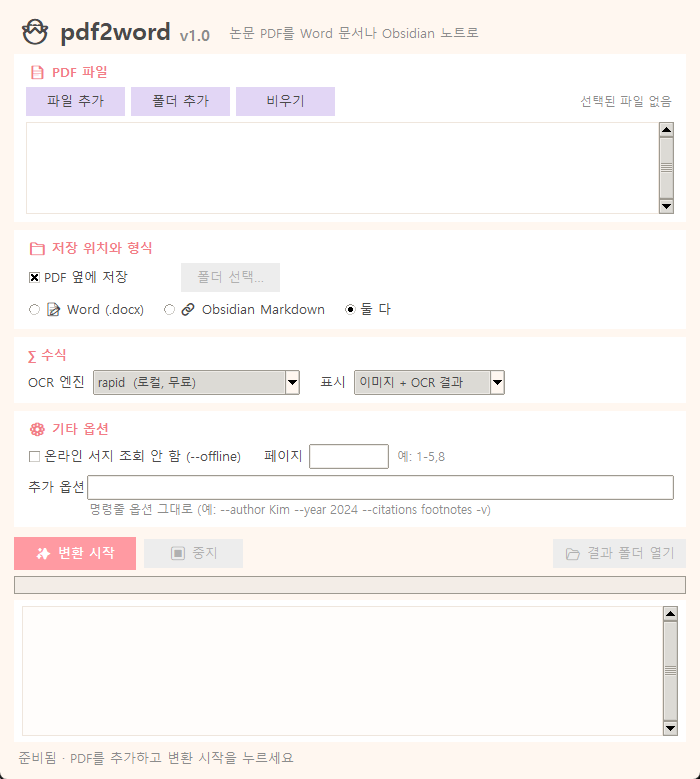
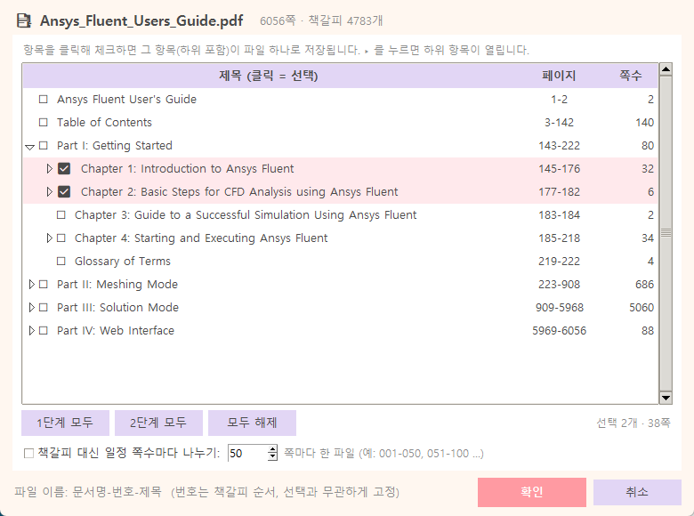

# pdf2word

현재 버전 **v1.5.0** · 변경 내역은 [CHANGELOG.md](CHANGELOG.md)

PDF를 **Word 문서(.docx)** 또는 **Obsidian 노트(.md)** 로 바꿔 주는 작은 도구입니다.
논문이면 본문·그림·표는 물론 **수식까지** 옮기고, 제목·저자·DOI 같은 서지정보도 자동으로 채워 줍니다.
책·매뉴얼·보고서처럼 논문이 아닌 PDF도 되고, 수천 쪽짜리 PDF는 **책갈피(목차)에서 필요한 챕터만 골라** 챕터별 파일로 나눠 변환합니다.
GPU가 없는 보통 노트북에서 돌아가고, 인터넷은 서지정보 조회에만 씁니다(없어도 됩니다).



**이런 걸 해 줍니다**

- 📄 본문, 제목, 섹션, 표, 그림을 원래 읽는 순서대로 옮깁니다.
- ∑ 수식은 **원본을 잘라낸 이미지**를 먼저 넣고, 그 아래에 OCR로 읽은 수식을 둡니다. Word에서는 **편집 가능한 Word 수식**, Obsidian에서는 `$$ … $$` LaTeX입니다. OCR이 미심쩍으면 `⚠ OCR 신뢰도 낮음` 표시가 붙으니 이미지와 대조하면 됩니다.
- 🖼 그림은 "Figure 3" 캡션에 맞춰 `fig3.png`, `fig3a.png`처럼 이름을 붙입니다.
- 🔖 DOI를 찾아 제목·저자·저널·연도를 받아 문서 머리(Word) 또는 frontmatter(Obsidian)에 넣습니다.
- 📑 책갈피가 있는 큰 PDF는 챕터를 골라 `문서명-03-챕터제목.docx`처럼 따로 저장합니다. 책갈피가 없으면 50쪽씩 나눌 수 있습니다. 쪽 번호는 책에 인쇄된 번호(`p. 201`)로 적습니다.
- ✒ 수식이 글자가 아니라 그림(벡터 도형)으로 들어간 매뉴얼도 식과 본문 기호를 찾아 넣습니다.

---

## 1. 설치 (처음 한 번)

**준비물**

| 항목 | 비고 |
|---|---|
| Windows 10/11 | macOS, Linux에서도 되지만 Word *수식* 변환은 Windows + Microsoft Office에서만 됩니다(없으면 LaTeX 문자열로 대신 적음). |
| Python | **따로 설치하지 않아도 됩니다.** `main_gui.bat`가 가상환경을 항상 **Python 3.12**로 만듭니다 — PC에 3.13/3.14만 있거나 Python이 아예 없어도 uv가 3.12를 내려받습니다(uv가 없으면 bat가 uv부터 설치). **3.13 이상은 안 됩니다** — 수식 OCR 패키지(`rapid_latex_ocr`)가 `numpy<2`를 요구하는데 numpy 1.x는 3.13용 배포 파일이 없어 설치가 실패합니다. 직접 설치하려면 [python.org](https://www.python.org/downloads/)에서 **3.12**를 받고 "Add Python to PATH"에 체크. |
| uv (선택, 권장) | 설치가 훨씬 빠릅니다: `pip install uv` 또는 `winget install astral-sh.uv`. 없으면 `main_gui.bat`가 처음 실행 때 공식 설치 스크립트(astral.sh)로 설치합니다(`%USERPROFILE%\.local\bin`, 관리자 권한 불필요). |

**설치**

1. 이 저장소를 `git clone` 하거나 ZIP으로 받아 적당한 폴더에 풉니다.
2. **`main_gui.bat`** 를 더블클릭합니다. 처음에는 가상환경을 만들고 필요한 패키지를 자동으로 설치합니다(인터넷 필요, 몇 분). 끝나면 창이 뜹니다. 가상환경은 PC에 어떤 Python이 깔려 있든 **항상 Python 3.12**로 만듭니다: ① uv가 있으면 uv가 설치된 3.12를 쓰거나 3.12를 내려받고, ② uv가 없고 `py -3.12`(또는 3.12인 `python`)가 있으면 그것으로 만들고, ③ 둘 다 없으면 uv를 설치한 뒤 ①로 갑니다. 이미 있는 가상환경도 Python이 3.12일 때만 쓰고, 아니면(예: 다른 PC에서 3.11이나 3.13으로 만든 것) 설치 도중 실패하는 대신 이유와 조치(폴더 삭제 후 재실행)를 알려 주고 멈춥니다.
3. 끝입니다. 첫 변환 때 수식 인식 모델(약 120 MB)을 한 번 내려받습니다.

`main_gui.bat`가 쓰는 가상환경은 아래 순서로 먼저 찾은 것입니다.

| 순서 | 위치 |
|---|---|
| 1 | 환경변수 `PDF2WORD_VENV`에 적은 폴더 |
| 2 | 이 폴더 안의 `.venv` 또는 `venv` |
| 3 | `D:\Venvs_collec\Common_venv\pdf2word_venv` (`D:\Venvs_collec\Common_venv` 폴더가 있는 PC) |
| 4 | 이 폴더 안에 새로 만드는 `.venv` |

`requirements.txt`가 바뀌거나 폴더를 옮기면 다음 실행 때 패키지를 자동으로 다시 맞춥니다.

직접 설치하고 싶으면 이 폴더에서 명령 프롬프트(또는 PowerShell)를 열고 (`uv venv`는 폴더의 `.python-version`에 적힌 3.12를 씁니다):

```bash
uv venv
```

```bash
uv pip install -e .
```

uv가 없으면 대신 (반드시 3.12):

```bash
py -3.12 -m venv .venv
```

```bash
.venv\Scripts\pip install -e .
```

> 폴더를 옮겼을 때: 폴더 안에 `.venv`가 있었다면 지우세요(가상환경은 만든 위치에 묶여 있습니다). 그다음 `main_gui.bat`를 실행하면 다시 연결됩니다.

---

## 2. 사용하기 (GUI)

1. **`main_gui.bat`** 를 더블클릭합니다. (패키지 검사가 끝나면 검은 콘솔 창은 닫히고 GUI 창만 남습니다. 명령 프롬프트나 PowerShell에서 이 폴더로 이동한 뒤 `.\main_gui.bat` 로 실행해도 같습니다.)
2. **📄 PDF 파일** – `파일 추가`로 PDF를 고릅니다. 여러 개를 한 번에 골라도 되고, `폴더 추가`로 폴더째 넣어도 됩니다. 목록에는 쪽수와 책갈피 개수가 함께 보입니다.
3. **📑 챕터 선택…** (책·매뉴얼처럼 큰 PDF일 때) – 목록에서 파일을 고르고 이 버튼을 누르면 책갈피 트리가 뜹니다. 항목을 체크하면 하위 항목까지 함께 체크되고 그 묶음이 **파일 하나**가 됩니다(하위 하나를 빼면 상위는 ▣로 바뀌고 나머지 하위가 각각 파일이 됩니다). 체크한 챕터를 절마다 따로 저장하려면 *하위 항목별 파일로 나누기*를 켜세요. 체크하지 않으면 문서 전체를 하나로 변환하고, 책갈피가 없는 PDF는 같은 창에서 *일정 쪽수마다 나누기*를 쓸 수 있습니다. 쪽 수는 책에 인쇄된 번호와 PDF 순번을 나란히 보여 줍니다.
4. **📁 저장 위치와 형식** – 기본은 *PDF 옆에 Word 저장*입니다. Obsidian 노트가 필요하면 `Obsidian Markdown`(또는 `둘 다`)을 고르고, `폴더 선택…`으로 vault 안의 폴더를 지정하면 바로 노트가 됩니다.
5. **∑ 수식** – 기본값 그대로 두면 됩니다. `p2t`(기본)는 무료 로컬 OCR(Pix2Text MFR 1.5), `rapid`는 무료 로컬 OCR이며 `p2t`를 못 쓸 때의 폴백, `claude`는 Anthropic API 키와 요금이 듭니다.
6. **⚙ 문서 종류** – 보통 *자동 판별*로 둡니다. 논문(첫 쪽에 DOI나 초록이 있는 글)은 서지 조회·초록·참고문헌을 처리하고, 책·매뉴얼은 파일명 그대로 저장합니다. 판별이 틀리면 직접 고르세요.
7. **✨ 변환 시작** – 아래 로그 창에 진행 상황이 흐르고, 끝나면 **📂 결과 폴더 열기**가 켜집니다.



챕터별 파일 이름은 `문서명-번호-챕터제목.docx`입니다(예: `Ansys_Fluent_Users_Guide-04-Chapter-4-Starting-and-Executing-Ansys-Fluent.docx`). 번호는 책갈피에서 같은 단계 항목의 순번이라 어떤 챕터를 고르든 바뀌지 않고, 자릿수는 항목 수에 맞춰 `01` 또는 `001`이 됩니다. 챕터가 쪽 중간에서 시작하거나 끝나면 책갈피가 가리키는 제목 줄에서 잘라 이웃 챕터의 내용은 넣지 않습니다. *하위 항목별로 나누기*를 켜면 `문서명-05-Chapter-5-Heat-Transfer.docx`(챕터 제목 뒤의 서론만), `문서명-012-5.1-….docx`, `문서명-013-5.2-….docx`처럼 저장됩니다. 문서 머리에는 책 제목과 쪽 범위가 `p. 201-205 (PDF 249-253)` 꼴로 들어갑니다.

처리 시간은 20쪽 논문 기준 보통 2~8분이고, 수식이 많을수록 깁니다. 같은 논문을 다시 돌리면 OCR 결과가 캐시되어 1분 안팎이면 끝납니다(캐시 형식이 바뀐 업데이트 뒤 — 예를 들어 캐시 버전 3이 처음 쓰이는 변환 — 에는 모든 식을 다시 읽어 첫 변환만큼 걸립니다). 6,056쪽 매뉴얼에서 5쪽짜리 절 하나를 떼어 내는 데는 15초 안팎이 걸립니다. 마지막에 쓴 설정은 기억됩니다.

GUI에 없는 옵션은 **추가 옵션** 칸에 명령줄 옵션을 그대로 적으면 됩니다(예: `--author Kim --year 2024 --citations footnotes`). 옵션 목록은 [5절](#5-고급-명령줄과-옵션)에 있습니다.

---

## 3. 결과물 보는 법

### Word (.docx) — 기본

파일 하나에 모든 그림과 수식 이미지가 들어 있습니다.

- 머리: 제목 → 저자 → 저널·연도·DOI → Keywords
- 본문: 섹션 제목(제목 1~3), 문단, 목록(번호 목록은 Word 자동 번호 대신 원문 번호를 그대로 적은 문단), 표(Word 표), 그림(캡션 스타일)
- 수식: `[원본 수식 이미지]` 바로 아래에 Word 수식과 오른쪽 정렬된 식 번호. 수식 위에서 더블클릭하면 Word 수식 편집기로 고칠 수 있습니다.
- 본문 속 작은 수식(ρ<sub>f</sub>, u<sub>i</sub> 같은 것)도 Word 수식으로 들어갑니다.

### Obsidian (.md + 에셋 폴더)

```
papers\
├── Ma-2025-Numerical-modeling-wet-milling-improved-CFD-DEM-VOF.md
└── _asset-Ma-2025\
    ├── fig1.png  fig2a.png  fig2b.png …   # 캡션(Figure 2.)에 맞춘 이름, 서브패널은 a/b/c
    ├── p7-img3.png                        # 캡션을 못 찾은 그림: p<PDF 쪽>-img<번호> (챕터·--pages로 일부만 변환해도 원본 PDF의 쪽 번호)
    └── eq-12.png                          # 수식 이미지(식 번호 기준)
```

- 노트 머리에 YAML frontmatter(title, authors, year, journal, doi, keywords, tags: paper …)가 들어가 Dataview 등에서 바로 쓸 수 있습니다.
- 그림은 `![[_asset-Ma-2025/fig2a.png]]` 위키링크로, Abstract는 `> [!abstract]` 콜아웃으로 들어갑니다.
- 수식은 이미지 다음에 `$$ … \tag{3} $$`가 오고 `^eq-3` 앵커가 붙어 `[[노트#^eq-3]]`처럼 링크할 수 있습니다.

---

## 4. 자주 묻는 질문

**수식이 틀리게 읽혔어요.**
OCR은 완벽하지 않습니다. 기본 엔진 `p2t`도 마찬가지여서, 항상 원본 이미지를 수식 위에 같이 넣습니다. 이미지를 보고 Word에서 고치거나, `--math-engine claude`(API 키 필요)나 `--math-engine rapid`로 다시 변환해 비교해 보세요. 정도가 심하면 자동으로 `⚠ OCR 신뢰도 낮음 (34%)` 표시가 붙습니다. 이 표시는 OCR 결과를 PDF의 텍스트 레이어와 대조해서 붙이는데, 텍스트 레이어가 깨진 PDF(구형 Elsevier 논문 등, 본문을 복사하면 `¼`·`ð`·`þ` 같은 글자가 나오는 것)에서는 대조할 기준이 없어 표시를 붙이지 않고 대신 로그와 Markdown 머리에 `equations_unverified` 건수를 적습니다. 이런 PDF는 수식을 이미지와 직접 대조하세요.

**Word에 수식 대신 `\frac{…}` 같은 글자가 들어가요.**
Microsoft Office가 없는 PC입니다. Word 수식은 Office에 포함된 변환 파일(`MML2OMML.XSL`)로 만들기 때문에, Office가 없으면 LaTeX 문자열로 대신 적습니다. Word 365에서는 그 글자를 선택해 `Alt + =` 로 수식으로 바꿀 수 있습니다.

**처음 실행이 오래 걸려요.**
첫 변환 때 수식 인식 모델을 한 번 내려받습니다. 기본 엔진 `p2t`는 모델 파일 3개(합계 약 120 MB)를 `%LOCALAPPDATA%\pdf2word\models\pix2text-mfr-1.5`(Windows, 그 외 `~/.cache/pdf2word/models`)에 받고 크기와 sha256을 검사합니다. 환경변수 `PDF2WORD_MODELS`로 모델 폴더를 바꿀 수 있습니다. 내려받지 못하면(오프라인·방화벽) 로그에 사유를 적고 `rapid`(RapidLaTeXOCR, 약 170 MB 별도)로 변환을 계속합니다. 직접 받으려면 https://huggingface.co/breezedeus/pix2text-mfr-1.5 에서 `encoder_model.onnx`, `decoder_model.onnx`, `tokenizer.json`을 위 폴더의 `pix2text-mfr-1.5`에 넣으세요. 새 pip 패키지는 필요 없습니다(onnxruntime·tokenizers는 이미 설치돼 있음).

**"pdf2word 패키지를 불러올 수 없습니다" 창이 떠요.**
가상환경 밖의 파이썬으로 실행된 것입니다. `main_gui.bat`로 실행하세요. 직접 실행하려면 가상환경의 `Scripts\python.exe`로 `main_gui.py`를 여세요.

**폴더를 옮겼더니 안 돼요.**
폴더 안에 `.venv`가 있었다면 지우고 `main_gui.bat`를 다시 실행하세요. 가상환경을 만들고 패키지를 다시 설치합니다.

**스캔한 PDF(글자가 선택되지 않는 PDF)는요?**
글자가 없으면 본문을 뽑을 수 없습니다. Tesseract OCR을 설치한 뒤 `--ocr-pages` 옵션을 쓰면 됩니다.

**한 페이지에 그림이 수십 장인 PDF가 너무 느려요.**
자동으로 이미지 묶음을 가볍게 만들어 처리하지만(`--no-lighten`으로 끌 수 있음), 그래도 느리면 `--pages 1-10`처럼 범위를 나눠 돌리세요.

**책 전체가 아니라 몇 개 챕터만 필요해요.**
GUI의 **📑 챕터 선택…**에서 체크하세요. 명령줄은 `pdf2word book.pdf --list-chapters`로 번호를 본 뒤 `--chapters 3.1,3.4`처럼 지정합니다. 수백 쪽짜리 챕터는 변환에 수십 분이 걸릴 수 있으니 ▸ 를 눌러 하위 절을 고르는 편이 빠릅니다.

**책갈피가 없는 큰 PDF는요?**
챕터 선택 창에서 *일정 쪽수마다 나누기*를 켜거나, 명령줄에서 `--split-pages 50`을 쓰면 `문서명-01-p0001-0050.docx`처럼 나뉩니다. `--pages 120-180`으로 범위를 직접 줄 수도 있습니다.

**논문이 아닌데 저자·DOI를 찾으려 하거나, 논문인데 일반 문서로 처리돼요.**
문서 종류 자동 판별이 틀린 경우입니다. GUI의 **문서 종류**(명령줄 `--doc-type paper` / `--doc-type document`)로 직접 정하세요.

**쪽 번호가 책에 찍힌 번호와 달라요.**
표지·목차 같은 앞부속 때문에 PDF 순번과 인쇄 번호가 다릅니다. PDF에 쪽 라벨이 있으면 그것을, 없으면 머리글·바닥글의 숫자로 인쇄 번호를 추정해 `p. 201 (PDF 249)`처럼 둘 다 적습니다. `--pages`와 GUI의 페이지 칸은 PDF 순번이 기본이고, `p201-205`처럼 `p`를 붙이면 인쇄 번호로 받습니다.

**매뉴얼의 수식이 번호만 남고 사라지거나, 본문의 기호(Ω, ε 같은)가 빠져요.**
수식을 글자가 아니라 그림(벡터 도형)으로 넣은 PDF입니다(Ansys 매뉴얼 등). v1.3부터 도형 묶음을 찾아 식은 이미지 + OCR 결과로, 본문 기호는 OCR 결과가 믿을 만하면 수식으로, 아니면 글자 크기의 작은 이미지로 그 자리에 넣습니다. 이런 PDF는 대조할 텍스트가 없어 OCR 오류를 잡아내기 어려우니, 정확한 수식이 필요하면 `--math-engine claude`를 쓰세요.

---

## 5. 고급: 명령줄과 옵션

GUI와 같은 기능을 명령줄로 쓸 수 있습니다(여러 파일 일괄 처리, 스크립트 자동화에 유리).

```bash
pdf2word paper.pdf                       # Word (기본)
pdf2word paper.pdf -f md -o D:\Vault\papers   # Obsidian 노트를 vault 폴더에
pdf2word "E:\Download\*.pdf" -f both     # 폴더 안 모든 PDF를 둘 다로
pdf2word paper.pdf --math-engine claude  # 수식 OCR을 Claude 비전으로
pdf2word paper.pdf --author Kim --year 2024 --offline   # 서지정보 직접 지정
pdf2word manual.pdf --list-chapters      # 책갈피 트리와 번호 보기 (--chapter-depth 3 으로 더 깊게)
pdf2word manual.pdf --chapters 3.1,3.4-3.6   # 고른 챕터만 각각 한 파일로
pdf2word manual.pdf --chapters all:2     # 2단계 항목(보통 Chapter) 전부
pdf2word manual.pdf --chapters 8 --subchapters   # Chapter 5를 절(5.1, 5.2 …)마다 파일로, 서론은 따로
pdf2word manual.pdf --pages p201-205     # 책에 인쇄된 쪽 번호로 범위 지정
pdf2word report.pdf --split-pages 50     # 책갈피 없는 PDF를 50쪽씩
python main_gui.py paper.pdf -f md       # main_gui.py 도 인자를 주면 명령줄로 동작
```

### 옵션

| 옵션 | 기본값 | 설명 |
|---|---|---|
| `-f, --format` | `docx` | `docx`(Word) / `md`(Obsidian Markdown + 에셋 폴더) / `both` |
| `-o, --out-dir` | PDF 폴더 | 출력 폴더 |
| `--doc-type` | `auto` | `paper`(논문: 서지 조회·초록·참고문헌 처리) / `document`(책·매뉴얼·보고서) / `auto`(첫 두 쪽에 DOI·arXiv·Abstract가 있으면 논문) |
| `--list-chapters` | | 책갈피 트리(번호, 쪽 범위)만 출력하고 변환하지 않음. `--chapter-depth`로 보이는 깊이 조절 |
| `--chapters` | | 변환할 책갈피 번호: `3,4.2,5.1-5.4`, `all`(1단계 전부), `all:2`(2단계 전부). 항목마다 파일 하나. 아무 항목도 고르지 않는 값(`3-1`, 없는 단계의 `all:9`, 빈 값)은 전체를 변환하지 않고 오류로 끝남 |
| `--chapter-split` | `exact` | 이웃 챕터와 쪽을 나눠 쓰는 경계를 책갈피 위치(제목 줄)에서 자름. `page`면 쪽 단위 |
| `--chapter-template` | `{stem}-{num}-{title}` | 챕터 파일 이름. `{id}`(책갈피 번호) `{p0}` `{p1}`(쪽 범위)도 사용 가능 |
| `--split-pages` | 0 | N쪽마다 한 파일(책갈피 없는 PDF용). 이름은 `{stem}-{num}-p0001-0050` |
| `--subchapters` | 끔 | 고른 항목을 바로 아래 하위 항목마다 파일로 나눔. 첫 하위 항목 앞의 서론은 항목 제목의 파일로 |
| `--math-engine` | `p2t` | `p2t`(Pix2Text MFR 1.5, 로컬·무료, 여러 줄 식을 통째로 읽음, 모델을 못 받으면 `rapid`로 대체) / `rapid`(RapidLaTeXOCR, 로컬, 폴백) / `claude`(API) / `none`(OCR 없이 이미지만) |
| `--math-zooms` | 엔진별 | 수식을 읽을 때 시도하는 렌더 배율을 순서대로(예: `4,3,2`). 생략하면 엔진 기본: `p2t` 4,3,2 / `rapid` 2,3,4. 숫자가 아니거나(`4x,3x`) 0·음수인 값은 오류(종료 코드 2) |
| `--math-mode` | `both` | `both`(이미지 + OCR 결과) / `latex`(OCR 결과만, 실패·불확실 시 이미지) / `image` |
| `--docx-math` | `native` | Word 수식: `native`(편집 가능한 수식, Office 필요) / `text`(LaTeX 문자열) |
| `--author`, `--year`, `--title` | 자동 | 서지정보를 직접 지정 (파일·폴더 이름에 쓰임) |
| `--offline` | 끔 | CrossRef/arXiv 조회 안 함 |
| `--asset-template` | 종류별 | 에셋 폴더 이름. 논문 `_asset-{author}-{year}`, 일반 문서 `_asset-{stem}`, 챕터 `_asset-{stem}-{num}`. 위키링크를 깨는 `[ ] # ^ \|`는 `-`로 바뀌고(`_asset-Manual-[2nd-ed]-#3` → `_asset-Manual-2nd-ed-3`), 같은 이름 폴더에 다른 노트의 그림이 있으면 `-2`, `-3`…을 붙임 |
| `--name-template` | 종류별 | 결과 파일 이름. 논문 `{author}-{year}-{title}`, 일반 문서 `{stem}` (`{stem}` = PDF 파일 이름) |
| `--image-links` | `wiki` | `wiki` = `![[…]]`, `markdown` = `` |
| `--citations` | `keep` | `footnotes`로 하면 `[12]` → `[^12]` 각주 |
| `--pages` | 전체 | `1-5,8`처럼 PDF 순번(1부터) 범위. `p201-205`, `pxii`처럼 `p`를 붙이면 인쇄 쪽 번호 |
| `--dpi` | 200 | 그림 해상도 |
| `--keep-headers` | 끔 | 머리글/바닥글 유지 |
| `--no-inline-math` | 끔 | 본문 속 수식 *이미지* OCR 끄기 |
| `--no-inline-text-math` | 끔 | 본문 속 *텍스트* 수식(ρ_f, u_i)의 변환 끄기 |
| `--no-vector-math` | 끔 | 벡터 도형으로 그려진 수식·기호 찾기 끄기 (매뉴얼용 기능) |
| `--no-block-ids` | 끔 | `^eq-3`, `^fig-2` 앵커 생략 |
| `--no-lighten` | 끔 | 이미지가 많은 페이지의 분석용 경량화 끄기 |
| `--ocr-pages` | 끔 | 스캔 PDF용 Tesseract OCR |
| `--no-overwrite` | 끔 | 결과가 이미 있으면 건너뜀 |
| `--claude-model`, `--claude-effort` | `claude-opus-5-5`, `low` | Claude 엔진 설정 (`ANTHROPIC_API_KEY` 환경변수 필요) |
| `--no-cache` | 끔 | OCR 결과 캐시 끄기 (캐시: `%LOCALAPPDATA%\pdf2word`) |
| `-v` | | 상세 로그 (OCR 결과, 인라인 수식 치환 내역) |

### Python에서 쓰기

```python
from pdf2word import convert
r = convert("paper.pdf", out_dir="D:/Vault/papers", format="both")
print(r.docx_path, r.md_path, r.asset_dir, r.stats)
```

---

## 6. 동작 원리 (간단히)

1. **레이아웃 분석** – `pymupdf4llm` + `pymupdf-layout`(CPU 전용 모델)이 페이지를 제목/본문/수식/그림/캡션/표/머리글 박스로 나누고 읽기 순서를 정합니다. 머리글·바닥글은 버립니다.
2. **수식** – 수식 박스를 원본에서 다시 그려 여백을 자르고, 식 번호를 분리한 뒤 Pix2Text MFR 1.5(ONNX, torch 없이 onnxruntime으로 구동)로 읽습니다. `p2t`는 여러 줄 식도 통째로 읽고, 폴백 `rapid`(RapidLaTeXOCR, pix2tex의 ONNX 버전)는 줄 단위로 읽어 합칩니다. 결과를 PDF 텍스트 레이어와 글자 단위로 대조해 유사도를 매기고, 낮으면 다른 배율로 다시 읽어 가장 잘 맞는 것을 고릅니다.
3. **Word 수식** – LaTeX → MathML(`latex2mathml`) → OMML(Office의 `MML2OMML.XSL`)로 바꿔 Word 수식 개체로 넣습니다.
4. **본문 수식** – 글꼴(CM, Symbol, CambriaMath …)·크기·기준선을 보고 ρ_f, u_i 같은 인라인 수식을 찾아 LaTeX로 바꿉니다. Word/MathType 문서에서 사라지는 Symbol 폰트 글자(ρ, ∂, α …)도 복구합니다.
5. **그림** – 그림 박스를 원본에서 렌더링하고 바로 아래/위 캡션으로 이름을 정합니다. 페이지마다 반복되는 로고는 뺍니다.
6. **서지정보** – 첫 두 쪽에서 DOI/arXiv ID를 찾아 CrossRef/arXiv API로 받고, 없으면 1쪽의 큰 글자(제목)·그 아래 줄(저자)·연도 패턴으로 추정합니다. 일반 문서는 PDF 속성의 제목·저자만 씁니다.
7. **책갈피** – PDF의 목차(outline)를 트리로 읽고, 다음 항목이 시작하는 쪽으로 각 항목의 쪽 범위를 정합니다. 고른 챕터는 그 쪽들만 떼어 낸 부분 문서로 만들어 위 과정을 그대로 거치므로 나머지 수천 쪽은 건드리지 않습니다. 경계 쪽에서는 책갈피가 가리키는 위치 근처에서 제목 글줄을 찾아 그 위(또는 다음 챕터 제목 아래)의 글을 지웁니다. 쪽 번호는 PDF의 쪽 라벨에서, 없으면 머리글·바닥글의 숫자에서 읽습니다.
8. **그림으로 그려진 수식** – 글리프 외곽선(벡터 도형)과 작은 이미지를 묶어 기호 단위로 만들고, 글줄 안에 있으면 본문 기호, 아니면 식으로 분류합니다. 식은 오른쪽의 `(5.95)` 번호를 찾아 붙이고 이미지 + OCR로 넣으며, 본문 기호는 OCR 결과가 글자·그리스 문자·아래첨자 꼴일 때만 수식으로, 아니면 글자 크기의 이미지로 넣습니다.

처리 시간 예(GPU 없는 노트북): MDPI 논문 23쪽·수식 13개 약 1~2분, 학회 논문 24쪽·수식 57개 약 7분. 대부분이 수식 OCR 시간입니다.

---

## 7. 알려진 한계

- 수식 OCR 정확도는 "보통"입니다. 굵은 벡터 기호, 긴 다중 행 식, 특이한 글꼴의 ∂에서 틀리기 쉽습니다. 이미지가 항상 함께 들어가는 이유입니다.
- 레이아웃 모델이 수식을 본문으로 분류하면 그 수식은 LaTeX로 바뀌지 않습니다(`-v` 로그에서 페이지별 수식 블록 수를 볼 수 있습니다).
- Word 수식 변환은 Windows + Office에서만 됩니다. 다른 환경에서는 LaTeX 문자열로 들어갑니다.
- 스캔 PDF는 Tesseract가 있어야 합니다.
- 그림으로 그려진 수식은 대조할 텍스트가 없어 OCR 오류를 걸러내기 어렵습니다. 적분 기호가 ⊕로, I가 l로 읽히는 식의 오류가 남을 수 있으니 이미지와 대조하거나 Claude 엔진을 쓰세요.
- 챕터 나누기는 PDF에 든 책갈피를 그대로 믿습니다. 책갈피가 쪽만 가리키고 위치가 없으면 경계는 쪽 단위로만 잘리고, 책갈피 자체가 틀린 PDF는 결과도 틀립니다. 책갈피가 없으면 쪽수로만 나눌 수 있습니다.

---

## 8. 테스트와 개발

```bash
uv sync --locked --extra dev          # 개발용 환경(.venv, Python 3.12, pytest 포함)
.venv\Scripts\python -m pytest tests -q   # 테스트 222개 (합성 데이터만, 모델·네트워크 불필요)
pdf2word sample.pdf --pages 1-5 -v    # 실제 변환 확인
```

다른 PC에서 개발을 이어가는 절차, 코드 지도, 의존성·버전 올리는 규칙은 [docs/DEVELOPMENT.md](docs/DEVELOPMENT.md)에 있습니다.
버전은 `pdf2word/__init__.py`의 `__version__` 한 곳에서 올립니다(`pyproject.toml`이 읽어 감). 변경 내역은 [CHANGELOG.md](CHANGELOG.md)에 적습니다.

---

## 9. 사용한 오픈소스

| 구성 요소 | 라이선스 | 용도 |
|---|---|---|
| [PyMuPDF](https://github.com/pymupdf/PyMuPDF), [PyMuPDF4LLM](https://github.com/pymupdf/pymupdf4llm), pymupdf-layout | AGPL-3.0 (또는 Artifex 상용) | PDF 읽기, 레이아웃 분석, Markdown 변환 |
| [Pix2Text MFR 1.5](https://huggingface.co/breezedeus/pix2text-mfr-1.5) 모델 ([Pix2Text](https://github.com/breezedeus/Pix2Text)) | MIT | 수식 OCR(`p2t`, 기본) |
| [RapidLaTeXOCR](https://github.com/RapidAI/RapidLaTeXOCR) ([LaTeX-OCR](https://github.com/lukas-blecher/LaTeX-OCR) 모델) | Apache-2.0 / MIT | 수식 OCR(`rapid`, 폴백) |
| [python-docx](https://github.com/python-openxml/python-docx) | MIT | Word 문서 작성 |
| [latex2mathml](https://github.com/roniemartinez/latex2mathml) | MIT | LaTeX → MathML |
| [Anthropic SDK](https://github.com/anthropics/anthropic-sdk-python) (선택) | MIT | Claude 비전 수식 OCR |

이 프로그램을 재배포할 때는 PyMuPDF 계열의 AGPL-3.0 조건이 적용된다는 점에 유의하세요.
